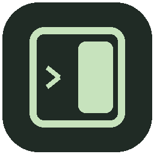
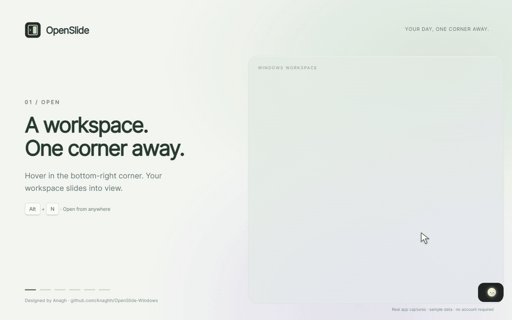

<div align="center">



# OpenSlide

**Your day, one corner away.**

Tasks, focus, notes, and calendars in a quiet Windows workspace.

[](https://github.com/Anaghh/OpenSlide-Windows/releases/latest)
[](https://github.com/Anaghh/OpenSlide-Windows/releases/latest)
[](https://github.com/Anaghh/OpenSlide-Windows/actions/workflows/windows.yml)
[](LICENSE)



[**Download for Windows**](https://github.com/Anaghh/OpenSlide-Windows/releases/latest) · [Watch the tutorial](docs/media/tutorial.mp4) · [Report a bug](https://github.com/Anaghh/OpenSlide-Windows/issues)

</div>

Hover in the **bottom-right corner** and OpenSlide slides into view. Plan a task, start a focus session, capture a thought, then return to your work. Everything you need stays close to hand.

## Get started

1. Download **OpenSlide-Setup-0.2.0.exe** from [Releases](https://github.com/Anaghh/OpenSlide-Windows/releases/latest).
2. Run the installer and launch OpenSlide from the Start Menu.
3. Hover in the bottom-right corner for a moment, or press **Alt+N**.
4. Open **Customize** to choose your corner, appearance, and companion.

Windows 10/11 **x64** is the current build target. The installer is unsigned. For portable use, download the portable ZIP, extract it, and run `OpenSlide.exe`; keep all extracted files together.

## A workspace that fits your day

| Feature | What you can do |
| --- | --- |
| **Tasks** | Add, edit, complete, reorder, duplicate, search, and schedule tasks. |
| **Focus** | Run a task countdown or stopwatch, pause/resume, add time, and finish a task. |
| **Notes** | Keep daily notes with autosave. Press **Ctrl+Enter** to turn a line or selection into a task. |
| **Calendar** | Browse a month, view tasks by day, and optionally connect Google Calendar for read-only events. |
| **Insights** | See actual focus time and task completions across 7 or 30 days. |
| **Reminders** | Set a task reminder and receive a Windows notification while the app is running. |

## Make it yours

Choose any of the four corners, or a centered top-edge calendar drawer. Bottom corners open a compact side panel; top positions open a horizontal drawer. Multi-monitor positioning uses Windows display coordinates and available work areas.

- **Appearance:** charcoal, paper, or midnight themes; mint, lavender, peach, or blue accents.
- **Typography:** bundled Inter by default, four bundled alternatives, an optional Avenir system font, and larger text settings.
- **Behavior:** hover and hide delays, automatic hiding, a pin to keep the panel open, and optional launch at login.
- **Companions:** nine quietly animated characters or the original icon. Disable motion or use Windows reduced-motion settings for a still character.

Native window sizes stay compact, with scrolling and responsive layouts for smaller displays. Glass intensity changes surface styling while maintaining readable text.

## Shortcuts

| Shortcut | Action |
| --- | --- |
| **Alt+N** | Open or collapse OpenSlide |
| **Escape** | Dismiss the current dialog or collapse the panel |
| **Ctrl+Enter** in Notes | Create a task from selected text or the current line |

The tray icon also opens the workspace. Closing the panel keeps timers and reminders running; choose **Quit OpenSlide** to exit.

## Your data stays with you

Tasks, notes, preferences, and focus history are stored locally at `%APPDATA%/OpenSlide/planner.json`. There are no analytics. Local planning requires no account. JSON export creates a backup without calendar credentials.

Saving uses a flushed temporary file and atomic rename. An unreadable planner file is preserved and reported rather than replaced. Focus checkpoints every 15 seconds and reopens paused after an interruption; time while the app is closed is not counted as work. Sleep, lock, and normal quit pause the timer.

**Google Calendar is optional** and makes network requests when connecting or loading events. Read the [calendar setup guide](docs/CALENDAR.md). Notion Calendar opens externally; its Google-backed events can be read through the same Google connection. Apple, Outlook, and Notion database event imports are not implemented.

**Reminders require OpenSlide to be running.** Windows notification settings may suppress banners or sound. Physical mixed-DPI monitor setups and live OAuth sign-in remain device/account checks beyond the automated tests.

## Development

Use Node.js **22 or later** on Windows.

```powershell
npm ci
npm start
```

```powershell
npm test                  # Planner, calendar provider, and geometry checks
npm run test:ui           # End-to-end app checks in a temporary profile
npm run test:tasks        # Task editing and management
npm run test:compact      # Corner layouts and chart visibility
npm run test:responsive   # Narrow layouts, large text, and accessibility
npm run dist              # Build the Windows installer
npm run docs:demo         # Record the README tutorial with sample data
```

The Windows implementation lives in [`windows/`](windows/). GitHub Actions checks the model/provider tests and builds an installer on Windows. Tagged builds publish release artifacts. See [CONTRIBUTING.md](CONTRIBUTING.md) and the [design review](docs/DESIGN.md) for development details.

## Author and license

Designed and maintained by **[Anagh](https://github.com/Anaghh)**. OpenSlide is [MIT licensed](LICENSE). Third-party font licenses are included with the assets and summarized in [NOTICE](NOTICE).
